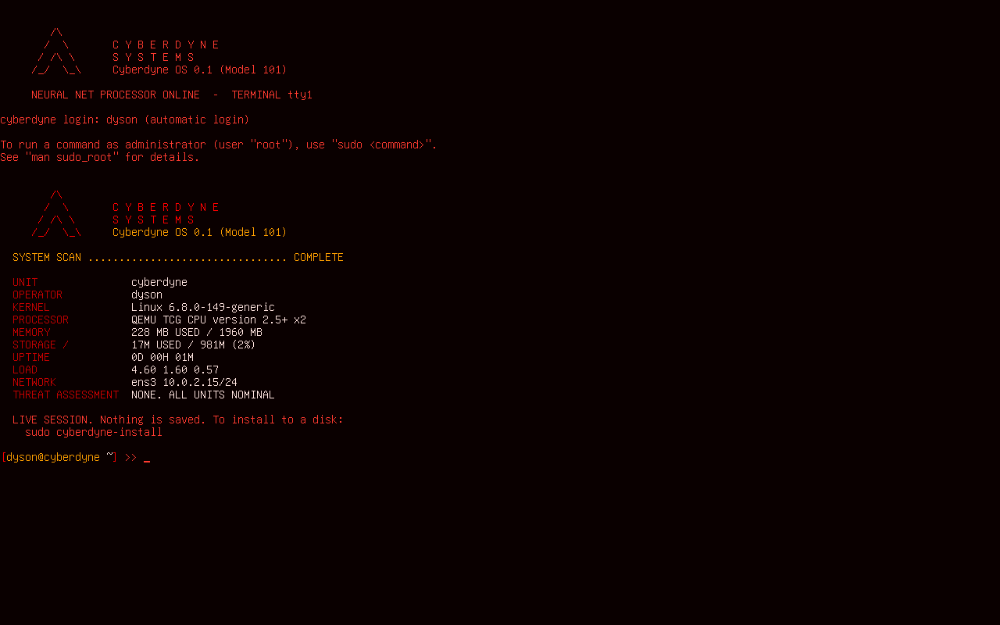

# Cyberdyne OS

A Linux operating system themed after Cyberdyne Systems from *The Terminator*
and *Terminator 2*. This is version 0.1 ("Model 101"): the base layers only.
It boots to a red-on-black text console, connects to a network, and can
install itself onto a disk. There is no graphical desktop yet.

```
        /\
       /  \       C Y B E R D Y N E
      / /\ \      S Y S T E M S
     /_/  \_\     Cyberdyne OS 0.1 (Model 101)
```



## What is in it

| Layer | What it does | Where it is defined |
|---|---|---|
| 0. Boot loader | GRUB, one image for BIOS and UEFI, red menu | `iso/boot/grub/grub.cfg` |
| 1. Kernel and early boot | Ubuntu 24.04 LTS kernel, hardware firmware, live-boot initramfs | `config/packages.list` |
| 2. Userland | systemd, bash, sudo, NetworkManager, disk and install tools | `config/packages.list` |
| 3. Identity | name, login banner, HUD colours, shell prompt, `hud` command | `rootfs/`, `config/palette`, `config/version` |

The base is Ubuntu 24.04 LTS, so `apt install <anything>` works and security
updates come from Ubuntu.

Themed pieces:

- **HUD colours.** All 16 console colours are remapped into reds and ambers
  (`config/palette`). `cyberdyne-palette standard` switches back to normal
  colours until reboot; `cyberdyne-palette hud` returns.
- **`hud`** (alias `scan`) prints a system scan: kernel, CPU, memory, disk,
  network, battery, failed services. It runs once at login.
- **Login banner and prompt**, and a sign-off when you log out.

## Get the ISO

It targets 64-bit Intel/AMD machines (`amd64`). That includes Intel Macs.
Apple Silicon Macs (M1 and later) cannot boot it directly; see Limits.

**From GitHub.** Each push that touches `cyberdyne-os/` runs the
"Build Cyberdyne OS ISO" workflow. Download `cyberdyne-os-iso` from the run's
Artifacts.

**On a Linux machine (Debian or Ubuntu):**

```sh
sudo apt install debootstrap squashfs-tools xorriso mtools dosfstools \
                 grub-pc-bin grub-efi-amd64-bin grub-common
cd cyberdyne-os
sudo ./build.sh          # result: out/cyberdyne-os-0.1-amd64.iso (about 1.2 GB)
```

On Debian, also install `ubuntu-keyring`. The build takes about five minutes
and needs 5 GB of free disk. `sudo ./build.sh clean` removes the build files.

## Try it

In a virtual machine (QEMU):

```sh
scripts/run-qemu.sh              # live session
scripts/run-qemu.sh disk.img     # live session plus an empty disk to install to
```

On a real machine, write the ISO to a USB stick (this erases the stick), then
boot from it. On an Intel Mac hold Option while powering on.

```sh
sudo dd if=out/cyberdyne-os-0.1-amd64.iso of=/dev/sdX bs=4M status=progress   # Linux
sudo dd if=out/cyberdyne-os-0.1-amd64.iso of=/dev/rdiskN bs=4m                # macOS
```

The live session logs in automatically as `dyson` (password `skynet`,
used for `sudo`).

## Install to a disk

From the live session:

```sh
sudo cyberdyne-install
```

It asks which disk, your login name, a password and a machine name, then
asks you to type `TERMINATE` before it erases the **whole disk**. It does not
set up dual boot. The installed system boots on BIOS and UEFI.

## Everyday use

| Task | Command |
|---|---|
| Wi-Fi or wired network | `nmtui` |
| Install software | `sudo apt update && sudo apt install NAME` |
| Update the system | `sudo apt update && sudo apt full-upgrade` |
| System scan | `hud` |
| Bigger console text (HiDPI) | edit `FONTSIZE` in `/etc/default/console-setup`, run `sudo setupcon` |

## Change it

- Add or remove software: `config/packages.list`
- Colours: `config/palette`
- Name and version: `config/version`
- Any file on the system: put it under `rootfs/` at the path it should have
- Build steps inside the system: `config/chroot-setup.sh`

Then run `sudo ./build.sh clean && sudo ./build.sh`.

## Limits of 0.1

- Text console only. No desktop, browser or sound setup yet.
- `amd64` only. Apple Silicon Macs need an ARM build, and on bare metal they
  additionally need the Asahi Linux boot chain.
- Secure Boot must be off (the boot loader is not signed).
- No disk encryption and no dual-boot option in the installer.
- Recent Intel Macs with a T2 chip need a patched kernel for the internal
  keyboard, trackpad and SSD; the stock kernel here does not have it.

## Next layers

1. Graphical session (Wayland compositor, login screen, terminal, browser)
   with the same red HUD theme.
2. Graphical boot splash.
3. Installer options: encryption, keeping an existing OS.
4. ARM64 build for virtual machines on Apple Silicon.

## Note

"Cyberdyne Systems" and *The Terminator* belong to their respective owners.
This is a personal fan-themed project and is not affiliated with them. It
uses no artwork, logos or audio from the films.
