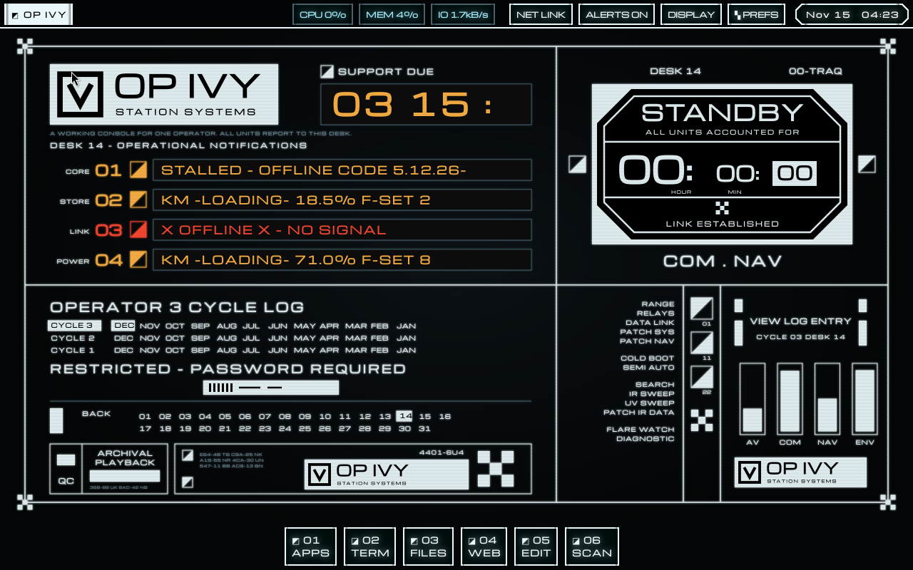
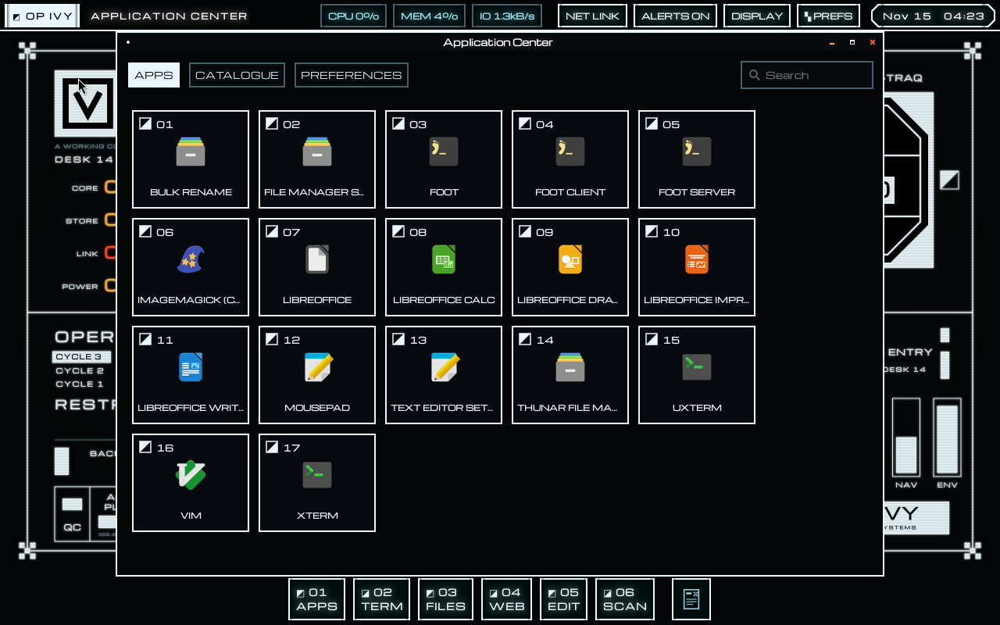
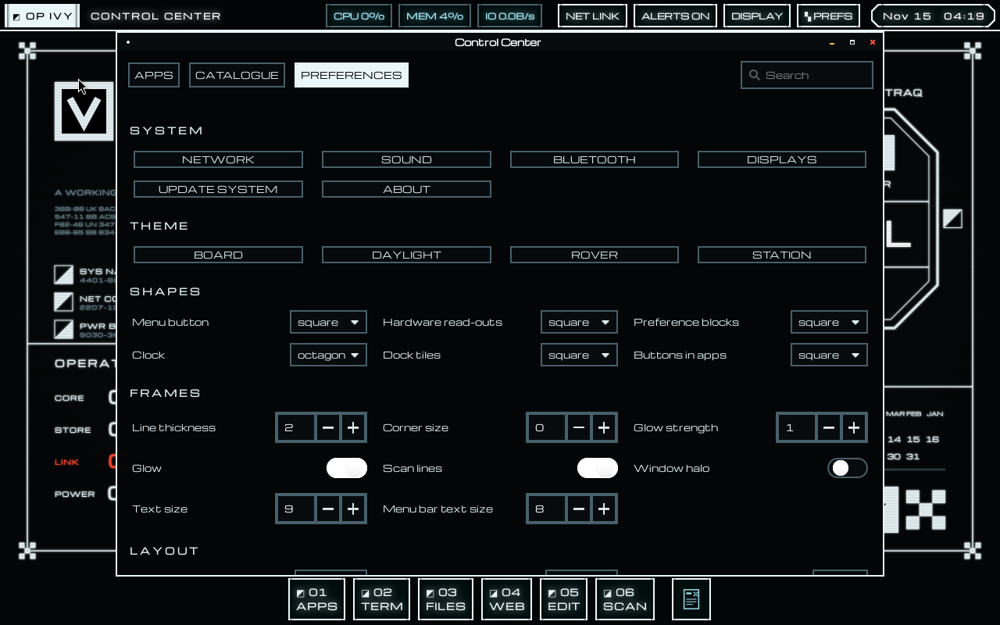
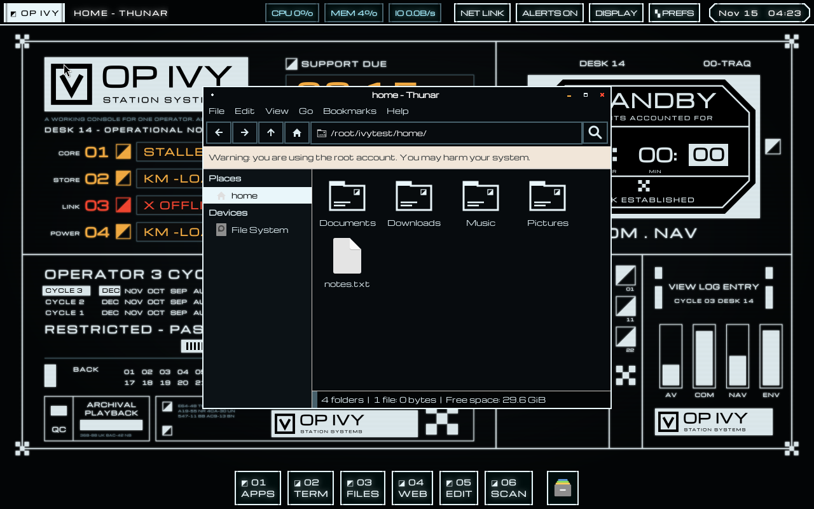
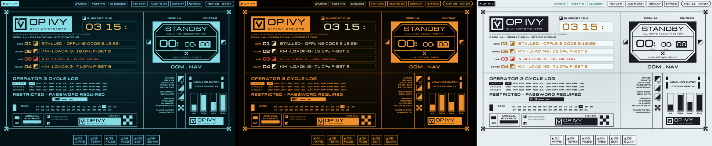

# Op Ivy

A Linux desktop operating system that looks like a monochrome station
console: white line-work on black, wide capital lettering, lit name plates,
eight-sided status frames, split-square markers and checkerboard register
marks. Version 0.1, "Standing By".

It is the same system as [Apsis OS](../os/README.md) with a different look.
The build, the tools, the settings and the shortcuts are identical; only the
themes, shapes, typeface, wallpaper, icons and boot text differ. The name is
set in one place, `config/version`.









The other three themes, `rover`, `board` and `daylight`:



## What makes the look

| Part | How it is drawn |
|---|---|
| Typeface | Michroma, a wide square sans, used for everything except the terminal. It ships in `rootfs/usr/share/fonts/truetype/opivy/` under the SIL Open Font License. |
| Menu bar | Square outlined blocks. The system button is a lit plate with dark lettering. The clock sits in an eight-sided frame. A block lights up when the pointer is on it. |
| Dock | App icons in square frames on a dark plate with a lit edge; a lit mark under each running app. `hudctl set dock_style labels` gives numbered word keys (01 APPS, 02 TERM …) instead. |
| Application Center | A grid of numbered keys. Bright keys are installed apps; dim keys can be installed. |
| Desktop | The live station console (see below): real read-outs, redrawn every second, and every panel clickable. `hudctl set wallpaper_style calm` gives a quiet grid with the name plate instead. Both follow the active theme. |
| Icons | Folders and files as square plates with the same markers. |
| Windows | Square corners, a thin frame, no shadow, and round red, yellow and green buttons at the top left. |
| Themes | `station` (white on black, the default), `rover` (pale cyan on dark teal), `board` (amber on black), `daylight` (black on white). |

Two frame shapes were added to the ones Apsis OS has: `square` and
`octagon`.

It is built on Ubuntu 26.04 LTS, so `apt install` and security updates work.
It shares no code with macOS; it copies the layout and habits, not the
internals.

## If you are coming from a Mac

It is laid out and behaves like macOS, in the station look.

| On macOS | Here |
|---|---|
| Apple menu | OP IVY at the top left: About This Computer, System Settings…, App Store…, Force Quit…, Sleep, Restart…, Shut Down…, Lock Screen, Log Out |
| App name in bold, and its menu | The front app's name next to it, in bold. Click it: About, Hide, Quit, Minimise, Zoom, Enter Full Screen, Close Window, Bring All to Front |
| Menu-bar extras, Control Center | NET, BT, VOL, ALERTS blocks; CONTROL opens the Control Center |
| Spotlight | SEARCH in the bar, or Cmd+Space |
| Clock | "Sun Nov 15 05:43 PM" at the top right |
| Dock | Pinned apps, then (after a divider) any other running app, then the Trash. A mark under an app means it is running. Click a running app to bring it to the front; click again to step through its windows. Rest the pointer for its name. Right-click: New Window, Show, Hide, Keep in Dock / Remove from Dock, Quit |
| Red, yellow, green buttons | Same colours, same place; grey on inactive windows; the sign shows on hover |
| Launchpad, Applications | Application Center: the grid icon in the dock, or Cmd+Shift+A |
| App Store | Catalogue in the Application Center, or App Store… in the system menu |
| Finder, Terminal, Safari, TextEdit | Files (Thunar), Terminal (foot), Web (Epiphany), Text Editor (Mousepad) |
| System Settings | Control Center: CONTROL in the bar, or Cmd+, |

| Keys | Does |
|---|---|
| Cmd+Q | Quit the app (all its windows) |
| Cmd+W | Close the window |
| Cmd+H / Cmd+M | Hide the app / minimise the window |
| Cmd+Tab | Switch windows |
| Cmd+Space | Spotlight-style search |
| Cmd+C, Cmd+X, Cmd+V, Cmd+A | Copy, cut, paste, select all, in the terminal and in text fields of GTK 3 apps (Files, Text Editor, dialogs) |
| Cmd+Option+Esc | Force Quit |
| Cmd+Shift+3 / 4 / 5 | Screenshot of the screen / of an area / the screenshot menu, saved to Pictures |
| Ctrl+Cmd+F | Full screen |
| Ctrl+Cmd+Q | Lock |
| Cmd+, | Control Center |
| Cmd+Shift+A | Application Center |

The Super (Windows) key is Cmd on a PC keyboard. Differences you will
notice: apps keep their own File/Edit/View menus inside their windows
rather than in the top bar; Cmd+C and Cmd+V do not reach GTK 4 apps such as
the Web browser (use Ctrl+C and Ctrl+V there); there is no Mission Control;
and Mac apps do not run.

## The menu bar's right side

**Preference blocks**: each shows a setting and changes it.

| Block | Shows | Click | Other |
|---|---|---|---|
| NET | connection, Wi-Fi name and strength | network settings | |
| BT | Bluetooth on, off, or device count | switch on or off | right-click: devices |
| LIGHT | screen brightness | | scroll to change |
| VOL | volume | sound settings | scroll to change, right-click to mute |
| PWR | battery | | |
| ALERTS | notifications on or off | switch | |
| CONTROL | | open Control Center | |
| SEARCH | | search apps | |

Blocks for hardware a machine lacks (battery, backlight, Bluetooth) hide
themselves. Choose and order them with `hudctl set bar_prefs ...`.
Processor, memory and network read-outs are available too (they are on the
console desktop already): `hudctl set bar_right tray,group/hardware,group/prefs,custom/search,clock`.

## The station console

The desktop itself is a working console, drawn by `hud-console` under all
windows and redrawn every second. Click any panel; the pointer turns into a
hand over the clickable parts and a tooltip says what each one does.

| Panel | Shows | Click |
|---|---|---|
| Name plate (top left) | | system menu |
| STATION TIME | the time | three-month calendar |
| 01 CORE | processor load, number of cores | process list |
| 02 STORE | disk use and free space | file manager |
| 03 LINK | network interface and address, or X OFFLINE X | network settings |
| 04 POWER | battery and charging, or uptime on mains | lock, log out, restart, shut down |
| Status frame (top right) | STANDBY or WORKING, failed services, uptime, link | system scan |
| COM . NAV | | network settings |
| CYCLE LOG | this month and today, in a three-year strip | the year's calendar |
| LOCK STATION | | lock the screen |
| QC | | screenshot |
| ARCHIVAL PLAYBACK | | Videos folder |
| Function list | NETWORK, BLUETOOTH, SOUND, DISPLAYS, UPDATE SYS, POWER MENU, LOCK, SEARCH, FILES, TERMINAL, APP CENTER, ALERTS, DIAGNOSTIC | each opens what it names |
| MUTE / THEME / PREFS keys | MUTE is lit while sound is muted | mute, change theme, Control Center |
| VIEW LOG ENTRY | today's date | system log |
| Meters | CPU, memory, disk, network | process list |

Right-click anywhere on the console for the system menu.

## Application Center

Open it from the grid icon in the dock, Cmd+Shift+A, or the system menu.

- **Apps**: every installed app as a numbered key. Click one to start it;
  type to filter.
- **Catalogue**: about 45 common apps by category. Dim keys can be
  installed, bright ones are installed. Pick one and press Install; a
  terminal opens, asks for your password and shows the download. To add
  apps to the catalogue, edit `/usr/share/hud/catalog.conf` or create
  `~/.config/hud/catalog.conf`.
- **Preferences**: the Control Center, below.

Anything not in the catalogue installs with `sudo apt install NAME`.

## Customising it

The Control Center (PREFS in the bar, or Cmd+,) has controls for themes,
shapes, frames, layout, colours and modules. Everything it does goes through
one tool, `hudctl`, and plain text settings, which you can also use directly.

### Shapes

Each group of blocks has its own outline, chosen from `square`, `octagon`,
`round`, `cut`, `tab`, `hex`, `slant`, `pill`, `bracket` and `hexagon`:

```sh
hudctl set shape_dock octagon     # dock tiles
hudctl set shape_hardware slant   # hardware read-outs
hudctl set shape_prefs tab        # preference blocks
hudctl set shape_menu hex         # the system menu button
hudctl set shape_clock square
hudctl set shape_button cut       # buttons inside apps
```

Frames everywhere follow three settings: `border_width` (line thickness),
`radius` (corner size, 0 by default for square corners) and `glow_strength`
(0 to 3). Folder and file icons
are drawn in the theme colours as part of the `icons` module.

### Commands

```sh
hudctl theme                    # list themes: station, rover, board, daylight
hudctl theme board              # switch; the desktop updates at once
hudctl get                      # every setting and its value
hudctl set line '#9fe6f5'       # change one colour
hudctl set dock_position left   # move the dock (bottom, left, right)
hudctl set bar_position bottom  # move the menu bar
hudctl set window_buttons right # window buttons on the right
hudctl set bar_right clock      # choose which read-outs the bar shows
hudctl set dock_apps 'APPS:hud-center apps,TERM:foot,MAIL:thunderbird'
hudctl set wallpaper ~/Pictures/photo.jpg    # or "generated"
hudctl set wallpaper_style calm # quiet desktop instead of the console
hudctl set console_live no      # console as a still picture, no clicks
hudctl set dock_style labels    # numbered word keys in the dock (or icons, mac)
hudctl set dock_icons 'MAIL:thunderbird'   # choose a dock icon by label
hudctl unset line               # back to the default
hudctl module                   # list the parts of the desktop
hudctl module off dock          # switch a part off (or on)
```


How it fits together:

- **Settings** are `key = value`. Defaults are in
  `/usr/share/hud/defaults.conf`, colours in the theme, and your changes in
  `~/.config/hud/settings.conf`.
- **Themes** are one small file of colours each. Copy one from
  `/usr/share/hud/themes/` to `~/.config/hud/themes/NAME.conf`, edit it, and
  run `hudctl theme NAME`.
- **Modules** are the parts of the desktop. Each is a folder of template
  files in `/usr/share/hud/modules/`; `hudctl apply` fills in the settings
  and writes the real config files. To change a part more deeply than the
  settings allow, copy its folder to `~/.config/hud/modules/` and edit the
  templates. Your copy replaces the system one. A new folder there is a new
  module.

| Module | Part of the desktop | Program underneath |
|---|---|---|
| `windows` | borders, title bars, shortcuts | labwc |
| `bar` | menu bar | waybar |
| `dock` | dock | hud-dock (or waybar for the other dock styles) |
| `launcher` | Cmd+Space search | fuzzel |
| `notify` | notifications | mako |
| `terminal` | terminal colours | foot |
| `wallpaper` | generated background | swaybg |
| `console` | live station console on the desktop | hud-console |
| `apps` | colours and button shapes inside apps | GTK |
| `icons` | folder and file icons | generated SVG |
| `lock` | lock screen, auto-lock | swaylock, swayidle |

Terminal windows that are already open keep their old colours after a theme
change; new ones use the new theme.

## Get the ISO

It targets 64-bit Intel/AMD machines (`amd64`), which includes Intel Macs.
Apple Silicon Macs (M1 and later) cannot boot it; see Limits.

**From GitHub.** Each push that touches `opivy/` runs the "Build Op Ivy ISO"
workflow. Download `opivy-iso` from the run's Artifacts.

**On a Linux machine (Debian or Ubuntu):**

```sh
sudo apt install debootstrap squashfs-tools xorriso mtools dosfstools \
                 grub-pc-bin grub-efi-amd64-bin grub-common
cd opivy
sudo ./build.sh          # result: out/opivy-0.1-amd64.iso (about 1.8 GB)
```

On Debian, also install `ubuntu-keyring`. The build takes about ten minutes
and needs 8 GB of free disk. `sudo ./build.sh clean` removes the build files.

## Try it

In a virtual machine (QEMU), giving it at least 4 GB of memory:

```sh
scripts/run-qemu.sh              # live session
scripts/run-qemu.sh disk.img     # live session plus an empty disk to install to
```

On a real machine, write the ISO to a USB stick (this erases the stick), then
boot from it. On an Intel Mac hold Option while powering on.

```sh
sudo dd if=out/opivy-0.1-amd64.iso of=/dev/sdX bs=4M status=progress   # Linux
sudo dd if=out/opivy-0.1-amd64.iso of=/dev/rdiskN bs=4m                # macOS
```

The live session logs in by itself as `live` (password `live`) and starts
the desktop.

## Install to a disk

Open a terminal in the live session and run:

```sh
sudo install-to-disk
```

It asks which disk, your login name, a password and a machine name, then
asks you to type `ERASE` before it erases the **whole disk**. It does not set
up dual boot. The installed system boots on BIOS and UEFI. After installing,
you log in by typing your name and password on a text screen, and the
desktop starts.

## Change the system itself

- Software included: `config/packages.list`
- Name and version: `config/version`
- Default settings, themes, modules: `rootfs/usr/share/hud/`
- Any other file on the system: put it under `rootfs/` at the path it
  should have
- Build steps inside the system: `config/chroot-setup.sh`

Then run `sudo ./build.sh clean && sudo ./build.sh`.

## What has been tested

The ISO was built and run in a QEMU virtual machine (software emulation),
with BIOS and with UEFI firmware. Checked there:

- GRUB starts the live system under BIOS and UEFI; it logs in by itself
  and the desktop starts.
- No failed services. Window manager, menu bar, live console, dock,
  notifications, idle lock, network applet and PipeWire all run.
- The console shows the machine's real state (load, disk, network address,
  uptime, date) and redraws every second; hovering outlines a panel and
  names it; clicking a panel opens what it says.
- Dock: clicking an app opens it, its running mark appears, the app in
  front is marked, right-click gives the dock menu, and Quit closes the
  app.
- Menu bar: the front app's name opens the app menu, and Zoom maximises the
  window between the bar and the dock. Right-clicking the desktop opens the
  system menu; Restart asks for confirmation.
- Red, yellow and green window buttons sit at the top left.
- Cmd+Return opens a terminal, Cmd+Space search, Cmd+Q quits the app.
- Wired network, name lookup and web access work. The sound card is found
  and the volume block shows its level.
- Switching theme recolours the bar, dock and desktop at once.
- Installing an app with apt works, and the Catalogue then shows it as
  installed.
- `install-to-disk` partitions, copies and installs GRUB; the installed
  disk boots under BIOS and under UEFI, and logging in starts the desktop.

Not yet tried on real hardware: Wi-Fi, Bluetooth devices, laptop
brightness and battery, suspend, and graphics chips other than the
virtual one.

## Limits of 0.1

- `amd64` only. Apple Silicon Macs need an ARM build, which would run in a
  virtual machine; running directly on that hardware also needs the Asahi
  Linux boot chain.
- Intel Macs from 2018 to 2020 (T2 chip) need a patched kernel for the
  internal keyboard, trackpad and SSD; the stock kernel here lacks it.
- Secure Boot must be off (the boot loader is not signed).
- Login is a text prompt; there is no graphical login screen yet.
- Windows and menus can only have square or rounded corners; the other
  shapes apply to bar blocks, dock tiles, app buttons and icons.
- The wide typeface takes more room than an ordinary one. On screens
  narrower than 1280 pixels, shorten the bar with `hudctl set bar_prefs ...`
  or lower `bar_font_size`.
- Installing from the catalogue asks for your password in a terminal.
- No global menu bar menus, no Mission Control, no Wi-Fi firmware for some
  Broadcom chips found in Macs.
- No disk encryption and no dual-boot option in the installer.

## Next layers

1. Graphical login screen.
2. Live desktop panels (system read-outs, feeds) as optional modules.
3. A dock that merges pinned apps with running ones and marks running apps with a dot.
4. ARM64 build for virtual machines on Apple Silicon.
5. Installer options: encryption, keeping an existing OS.

## Note

The look is an original design in the style of late-1970s industrial
console graphics. The name, the mark, the wording and the artwork are its
own; it uses no logos, names or artwork from any film, series or company.
