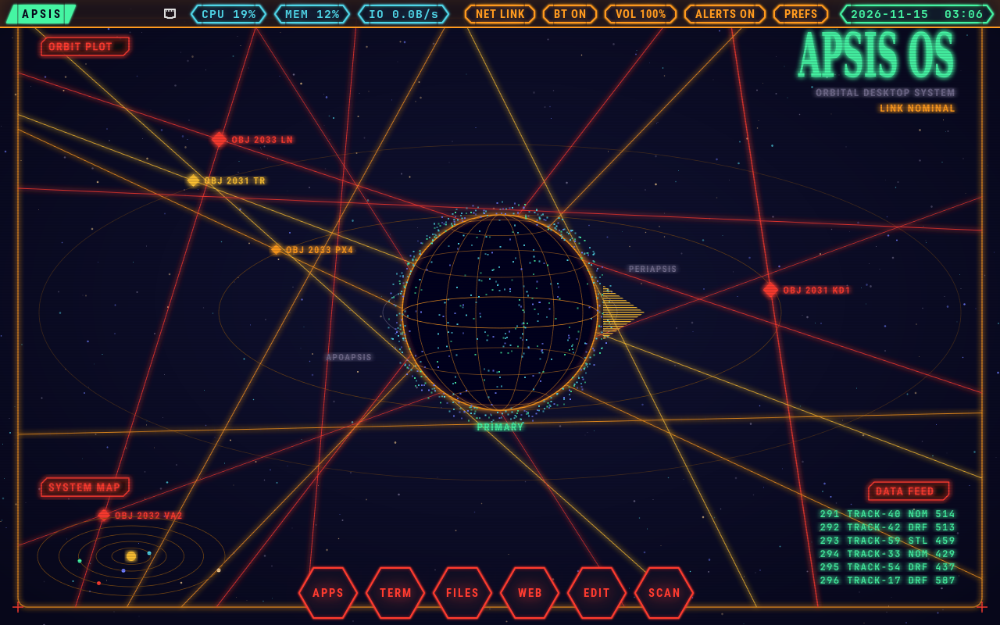
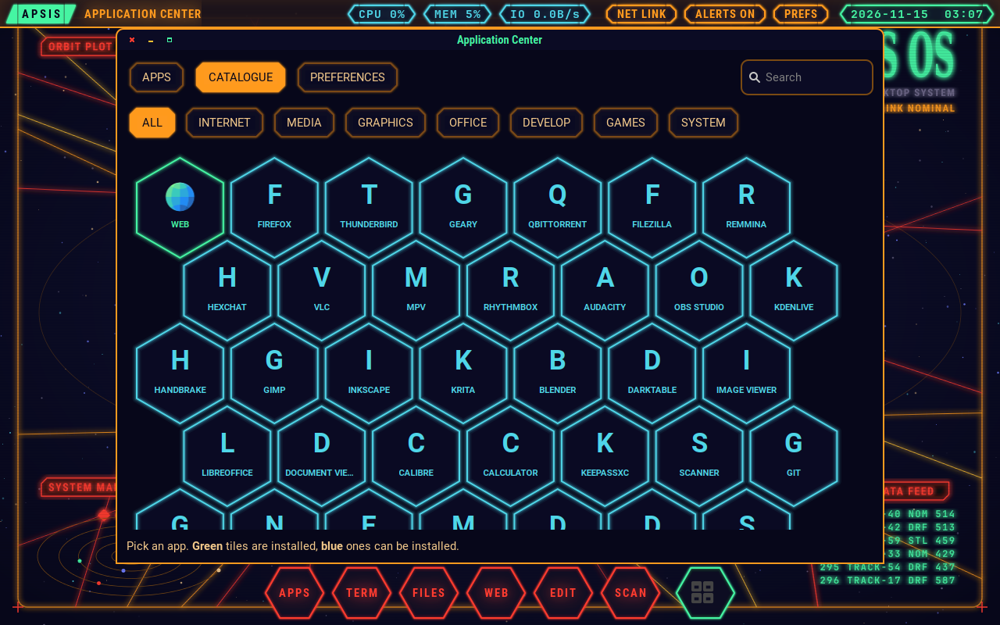
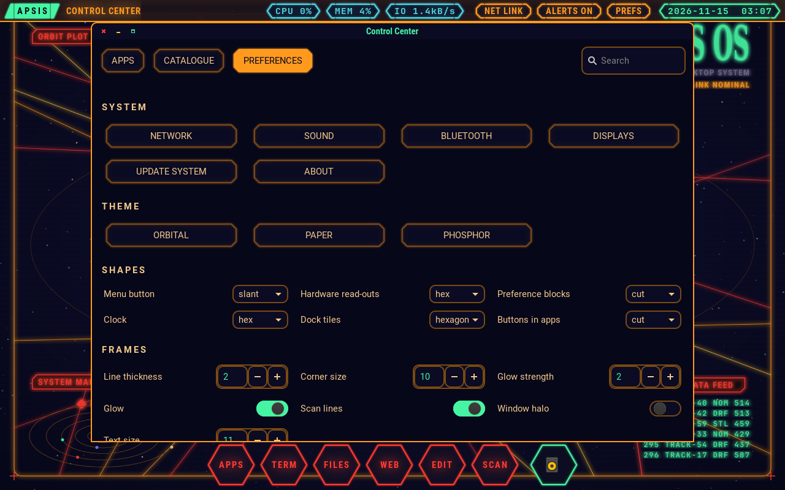

# Apsis OS

A Linux desktop operating system laid out like macOS (menu bar on top, dock
at the bottom, Command-key shortcuts) with a retro-futurist "orbital
tracking" look, where every part of the look and layout is a setting you can
change. Version 0.3, "First Light".

"Apsis OS" is a working name. It is set in one place, `config/version`.







It is built on Ubuntu 26.04 LTS, so `apt install` and security updates work.
It shares no code with macOS; it copies the layout and habits, not the
internals.

## If you are coming from a Mac

| On macOS | Here |
|---|---|
| Menu bar | Bar at the top: system menu, window title, hardware read-outs, preference blocks, clock |
| Apple menu | The button at the top left |
| Dock | Dock at the bottom: pinned launcher tiles, then open windows |
| Launchpad, App Store | Application Center: the APPS tile, or Cmd+A |
| Spotlight (Cmd+Space) | Launcher, Cmd+Space |
| Close, minimise, zoom at top left | Same place (can be moved right) |
| Cmd+Q, Cmd+W | Close the window |
| Cmd+M, Cmd+H | Minimise |
| Cmd+Tab | Switch windows |
| Ctrl+Cmd+F | Full screen |
| Ctrl+Cmd+Q | Lock |
| Cmd+Shift+3 / Cmd+Shift+4 | Screenshot of the screen / of an area, saved to Pictures |
| Cmd+, | Open preferences |
| Finder, Terminal, Safari, TextEdit | Thunar, foot, Web (Epiphany), Mousepad |
| System Settings | Control Center: the PREFS block in the bar, or Cmd+, |

Differences you will notice: copy and paste are Ctrl+C and Ctrl+V, each
window carries its own menus rather than the top bar showing them, and Mac
apps do not run.

## The menu bar's right side

Two groups of blocks, each with its own shape and colour:

- **Hardware read-outs** (blue): processor load, memory in use, temperature,
  network traffic. Click one for a process list. Also available: `disk`,
  `cpu#load`.
- **Preference blocks** (amber): each shows a setting and changes it.

| Block | Shows | Click | Other |
|---|---|---|---|
| NET | connection, Wi-Fi name and strength | network settings | |
| BT | Bluetooth on, off, or device count | switch on or off | right-click: devices |
| LIGHT | screen brightness | | scroll to change |
| VOL | volume | sound settings | scroll to change, right-click to mute |
| PWR | battery | | |
| ALERTS | notifications on or off | switch | |
| PREFS | | open Control Center | |

Blocks for hardware a machine lacks (battery, backlight, Bluetooth) hide
themselves. Choose and order the blocks with `hudctl set bar_hardware ...`
and `hudctl set bar_prefs ...`; more are listed in
`/usr/share/hud/defaults.conf`.

## Application Center

Open it from the APPS tile in the dock, Cmd+A, or the system menu.

- **Apps**: every installed app as a honeycomb. Click one to start it; type
  to filter.
- **Catalogue**: about 45 common apps by category. Blue cells can be
  installed, green ones are installed. Pick one and press Install; a
  terminal opens, asks for your password and shows the download. To add
  apps to the catalogue, edit `/usr/share/hud/catalog.conf` or create
  `~/.config/hud/catalog.conf`.
- **Preferences**: the Control Center, below.

Anything not in the catalogue installs with `sudo apt install NAME`.

## Customising it

The Control Center (PREFS in the bar, or Cmd+,) has controls for themes,
shapes, frames, layout, colours and modules. Everything it does goes through
one tool, `hudctl`, and plain text settings, which you can also use directly.

### Shapes

Each group of blocks has its own outline, chosen from `round`, `cut`, `tab`,
`hex`, `slant`, `pill`, `bracket` and `hexagon`:

```sh
hudctl set shape_dock pill        # dock tiles
hudctl set shape_hardware slant   # hardware read-outs
hudctl set shape_prefs tab        # preference blocks
hudctl set shape_menu hex         # the system menu button
hudctl set shape_clock cut
hudctl set shape_button round     # buttons inside apps
```

Frames everywhere follow three settings: `border_width` (line thickness),
`radius` (corner size) and `glow_strength` (0 to 3). Folder and file icons
are drawn in the theme colours as part of the `icons` module.

### Commands

```sh
hudctl theme                    # list themes: orbital, phosphor, paper
hudctl theme phosphor           # switch; the desktop updates at once
hudctl get                      # every setting and its value
hudctl set line '#00c8ff'       # change one colour
hudctl set dock_position left   # move the dock (bottom, left, right)
hudctl set bar_position bottom  # move the menu bar
hudctl set window_buttons right # window buttons on the right
hudctl set bar_right clock      # choose which read-outs the bar shows
hudctl set dock_apps 'APPS:hud-center apps,TERM:foot,MAIL:thunderbird'
hudctl set wallpaper ~/Pictures/photo.jpg    # or "generated"
hudctl set wallpaper_seed 12    # a different generated plot
hudctl unset line               # back to the default
hudctl module                   # list the parts of the desktop
hudctl module off dock          # switch a part off (or on)
```


How it fits together:

- **Settings** are `key = value`. Defaults are in
  `/usr/share/hud/defaults.conf`, colours in the theme, and your changes in
  `~/.config/hud/settings.conf`.
- **Themes** are one small file of colours each. Copy one from
  `/usr/share/hud/themes/` to `~/.config/hud/themes/NAME.conf`, edit it, and
  run `hudctl theme NAME`.
- **Modules** are the parts of the desktop. Each is a folder of template
  files in `/usr/share/hud/modules/`; `hudctl apply` fills in the settings
  and writes the real config files. To change a part more deeply than the
  settings allow, copy its folder to `~/.config/hud/modules/` and edit the
  templates. Your copy replaces the system one. A new folder there is a new
  module.

| Module | Part of the desktop | Program underneath |
|---|---|---|
| `windows` | borders, title bars, shortcuts | labwc |
| `bar` | menu bar | waybar |
| `dock` | dock | waybar |
| `launcher` | Cmd+Space search | fuzzel |
| `notify` | notifications | mako |
| `terminal` | terminal colours | foot |
| `wallpaper` | generated background | swaybg |
| `apps` | colours and button shapes inside apps | GTK |
| `icons` | folder and file icons | generated SVG |
| `lock` | lock screen, auto-lock | swaylock, swayidle |

Terminal windows that are already open keep their old colours after a theme
change; new ones use the new theme.

## Get the ISO

It targets 64-bit Intel/AMD machines (`amd64`), which includes Intel Macs.
Apple Silicon Macs (M1 and later) cannot boot it; see Limits.

**From GitHub.** Each push that touches `os/` runs the "Build OS ISO"
workflow. Download `os-iso` from the run's Artifacts.

**On a Linux machine (Debian or Ubuntu):**

```sh
sudo apt install debootstrap squashfs-tools xorriso mtools dosfstools \
                 grub-pc-bin grub-efi-amd64-bin grub-common
cd os
sudo ./build.sh          # result: out/apsis-0.3-amd64.iso (about 1.8 GB)
```

On Debian, also install `ubuntu-keyring`. The build takes about ten minutes
and needs 8 GB of free disk. `sudo ./build.sh clean` removes the build files.

## Try it

In a virtual machine (QEMU), giving it at least 4 GB of memory:

```sh
scripts/run-qemu.sh              # live session
scripts/run-qemu.sh disk.img     # live session plus an empty disk to install to
```

On a real machine, write the ISO to a USB stick (this erases the stick), then
boot from it. On an Intel Mac hold Option while powering on.

```sh
sudo dd if=out/apsis-0.3-amd64.iso of=/dev/sdX bs=4M status=progress   # Linux
sudo dd if=out/apsis-0.3-amd64.iso of=/dev/rdiskN bs=4m                # macOS
```

The live session logs in by itself as `live` (password `live`) and starts
the desktop.

## Install to a disk

Open a terminal in the live session and run:

```sh
sudo install-to-disk
```

It asks which disk, your login name, a password and a machine name, then
asks you to type `ERASE` before it erases the **whole disk**. It does not set
up dual boot. The installed system boots on BIOS and UEFI. After installing,
you log in by typing your name and password on a text screen, and the
desktop starts.

## Change the system itself

- Software included: `config/packages.list`
- Name and version: `config/version`
- Default settings, themes, modules: `rootfs/usr/share/hud/`
- Any other file on the system: put it under `rootfs/` at the path it
  should have
- Build steps inside the system: `config/chroot-setup.sh`

Then run `sudo ./build.sh clean && sudo ./build.sh`.

## Limits of 0.3

- `amd64` only. Apple Silicon Macs need an ARM build, which would run in a
  virtual machine; running directly on that hardware also needs the Asahi
  Linux boot chain.
- Intel Macs from 2018 to 2020 (T2 chip) need a patched kernel for the
  internal keyboard, trackpad and SSD; the stock kernel here lacks it.
- Secure Boot must be off (the boot loader is not signed).
- Login is a text prompt; there is no graphical login screen yet.
- Windows and menus can only have rounded corners; the other shapes apply
  to bar blocks, dock tiles, app buttons and icons.
- Installing from the catalogue asks for your password in a terminal.
- No global menu bar menus, no Mission Control, no Wi-Fi firmware for some
  Broadcom chips found in Macs.
- No disk encryption and no dual-boot option in the installer.

## Next layers

1. Graphical login screen.
2. Live desktop panels (system read-outs, feeds) as optional modules.
3. A custom dock with running-app indicators.
4. ARM64 build for virtual machines on Apple Silicon.
5. Installer options: encryption, keeping an existing OS.

## Note

The look is an original design in a retro-futurist style. It uses no
artwork, fonts or names from any film or series.
